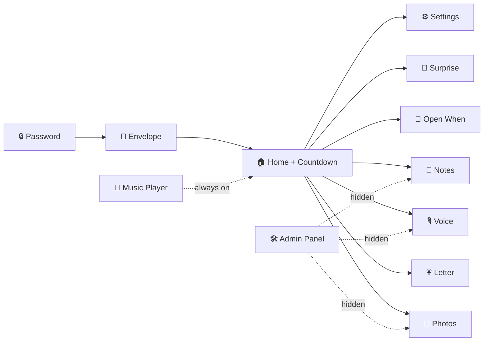

<div align="center">

# 💌 Her Little Universe

### *A tiny, scrapbook-style birthday website made with all my love* 🌸

<br>


<br>

**🎀 Cute scrapbook · 🫧 Liquid glass · 🎁 3D gift box · 🎵 Music & voice notes · 💗 Zero dependencies**

</div>

---

## 📖 Table of Contents

- [✨ What is this?](#-what-is-this)
- [🌈 Feature Tour](#-feature-tour)
- [🗺️ Website Structure](#️-website-structure)
- [🧰 Tech Stack](#-tech-stack)
- [📁 Project Files](#-project-files)
- [🚀 Quick Start (Demo Mode)](#-quick-start-demo-mode)
- [🔌 Connect Supabase](#-connect-supabase)
- [🛡️ Admin-Only Security (RLS)](#️-admin-only-security-rls)
- [🎨 Make It Yours (Config)](#-make-it-yours-config)
- [🎁 Birthday Surprise Media](#-birthday-surprise-media)
- [🌐 Deploy](#-deploy)
- [🔐 Password Screen: Honest Note](#-password-screen-honest-note)
- [⚠️ Known Limitations](#️-known-limitations)
- [🧪 Tested](#-tested)
- [🙏 Credits](#-credits)

---

## ✨ What is this?

**Her Little Universe** is a personal birthday website: a private little world with a letter, photos, voice messages, music, notes, "Open when…" letters and a **3D birthday gift box** surprise.

It is built with **plain HTML, CSS and JavaScript (3 files only)**. No framework, no build step, no npm. Photos, music, voice notes and notes live in **Supabase**, and the owner manages everything from a hidden **Admin Panel**.

> 💡 Works in **Demo Mode** with zero setup. Just open `index.html`.

---

## 🌈 Feature Tour

### 🔒 1. Password Unlock
A premium glass password screen is the first thing visitors see. The rest of the site does not even start running until the correct code is entered.

### 💌 2. Animated Birthday Envelope
A smooth envelope opens with a wax-seal heart, and the letter slides out before the site appears.

### 🏠 3. Home + Live Countdown
Hero with elegant typography, a live **days / hours / minutes / seconds** countdown to the birthday, and clickable section cards. On the birthday itself it celebrates with confetti. 🎉

### 💗 4. Birthday Letter
Lined-paper letter that unfolds with a gentle animation. The text lives in one place (`CONFIG.LETTER`) and supports emoji.

### 📸 5. Photo Gallery
- Polaroid-style cards with tape and sticker icons
- Hover zoom, shine, and a lightbox viewer with **previous / next, arrow keys and swipe**
- Captions can hold **emoji, line breaks and up to 20,000 characters**

### 🎙️ 6. Voice Messages
Beautiful voice cards with custom play / pause, a seekable progress bar and timers. Music pauses automatically while a voice note plays, then resumes.

### 🎵 7. Music Player
A floating glass player with previous / play / next, a seek bar, mute, an animated equalizer and an auto-playing playlist loaded from Supabase.

### 📝 8. Notes (20,000 characters)
She can stick notes on the wall. Live counter (`0 / 20000`), multiline text, emoji, scrollable long notes. Admin can edit and delete.

### 💌 9. Open When… Letters
Six envelope cards (happy, sad, miss me, before sleep, doubting yourself, birthday). Each opens a beautiful letter dialog. Edit the words in **one clearly marked block** in `script.js`.

### 🎁 10. Birthday Surprise (3D)
A CSS 3D gift box that **spins forever** until touched. Then it stops, the **lid lifts**, a glow and confetti appear, and the surprise is revealed with a message and optional **image or video**.

### 🛠️ 11. Admin Panel
Hidden behind a lock icon. Upload photos / music / voice, edit titles, delete with confirmation, manage the playlist, and edit or remove notes. Nothing is visible to public visitors.

### ⚙️ 12. Settings
- 🌸 **Original pink** theme
- 🌙 **Midnight lavender** theme
- 🎞️ Turn decorative animations on / off
- Saved on the device only

### 🧭 13. Smooth Navigation
Every section is its own screen with fade transitions, a Back / Home bar, and working browser **Back / Forward** buttons (History API). Music keeps playing between screens.

### 😀 14. Emoji Everywhere
Colour-emoji font fallbacks and safe text wrapping, so emoji and long text look right on mobile and desktop.

---

## 🗺️ Website Structure



---

## 🧰 Tech Stack

| Layer | Used | Notes |
|---|---|---|
| 🧱 Markup | **HTML5** | Semantic, accessible, one page |
| 🎨 Styling | **CSS3** | Variables, glassmorphism, CSS 3D, themes |
| ⚡ Logic | **Vanilla JavaScript** | No framework, no build |
| 🗄️ Backend | **Supabase** | Storage (photos, music, voice), Postgres (notes), Auth (admin) |
| 🖼️ Icons | **Inline SVG** | One consistent icon set, no library |
| 🔤 Fonts | **Google Fonts** | Cormorant Garamond, Gochi Hand, Patrick Hand |

---

## 📁 Project Files

```
her-little-universe/
├── 📄 index.html   → structure, sections, icons, dialogs
├── 🎨 style.css    → scrapbook + liquid-glass design, themes, animations
└── ⚡ script.js    → all logic: gate, navigation, Supabase, player, admin
```

> Only these 3 files are needed.

---

## 🚀 Quick Start (Demo Mode)

1. **Download or clone** this repository.
2. Open `index.html` in your browser.
3. Without Supabase keys, the site runs in **Demo Mode** with sample photos. You can try the envelope, letter, countdown, gift box and settings right away.

---

## 🔌 Connect Supabase

### 1️⃣ Create a project
Create a free project at [supabase.com](https://supabase.com).

### 2️⃣ Run the setup SQL
In the Supabase **SQL Editor** run:

```sql
-- Storage buckets (public read)
insert into storage.buckets (id, name, public) values
  ('photos','photos',true), ('music','music',true), ('voices','voices',true)
on conflict (id) do nothing;

create policy "public read" on storage.objects for select
  using (bucket_id in ('photos','music','voices'));

-- Notes table
create table if not exists notes (
  id bigint generated always as identity primary key,
  message text not null check (char_length(message) <= 300),
  created_at timestamptz default now()
);
alter table notes enable row level security;
create policy "anyone read notes" on notes for select using (true);
create policy "anyone add notes" on notes for insert with check (true);
```

### 3️⃣ Create your admin user
**Authentication → Users → Add user** (email + password, tick *Auto Confirm User*).
Then **turn off public sign-ups**: *Authentication → Sign In / Providers → "Allow new users to sign up" = off*.

### 4️⃣ Add your keys
Open `script.js` and fill the `CONFIG` block:

```js
const CONFIG = {
  SUPABASE_URL: "https://YOUR-PROJECT.supabase.co",
  SUPABASE_ANON_KEY: "YOUR_PUBLIC_ANON_KEY",
  NAME: "Her nickname",
  FROM: "Your name",
  BIRTH_MONTH: 11,
  BIRTH_DAY: 27,
  LETTER: [ "Your letter, one line per paragraph..." ]
};
```

> ⚠️ Use only the **anon / publishable** key. **Never** put the `service_role` key in this project.

---

## 🛡️ Admin-Only Security (RLS)

The admin buttons are hidden for visitors, but **hidden buttons are not security**. Real protection is enforced by the database. Run this too, so only the listed admin can write:

```sql
-- Admin allowlist
create table if not exists public.admins (
  user_id uuid primary key references auth.users(id) on delete cascade
);
alter table public.admins enable row level security;
create policy "admin reads own row" on public.admins
  for select to authenticated using (user_id = auth.uid());

create or replace function public.is_admin() returns boolean
language sql stable security definer set search_path = public as $$
  select exists (select 1 from public.admins where user_id = auth.uid());
$$;
revoke all on function public.is_admin() from public;
grant execute on function public.is_admin() to anon, authenticated;

-- Storage: only the admin can upload / rename / delete
create policy "admin upload" on storage.objects for insert to authenticated
  with check (bucket_id in ('photos','music','voices') and public.is_admin());
create policy "admin update" on storage.objects for update to authenticated
  using (bucket_id in ('photos','music','voices') and public.is_admin())
  with check (bucket_id in ('photos','music','voices') and public.is_admin());
create policy "admin delete" on storage.objects for delete to authenticated
  using (bucket_id in ('photos','music','voices') and public.is_admin());

-- Notes: everyone can read and add, only the admin can edit or delete
create policy "admin edit notes" on public.notes for update to authenticated
  using (public.is_admin()) with check (public.is_admin());
create policy "admin delete notes" on public.notes for delete to authenticated
  using (public.is_admin());

-- Make YOURSELF the admin (use the email of the user you created)
insert into public.admins (user_id)
select id from auth.users where email = 'YOUR_EMAIL_HERE'
on conflict do nothing;
```

### How to open the Admin Panel
Tap the small 🔒 icon in the footer (or open `…/#admin`), log in, and use the **Admin bar**: ➕ Add · 🎵 Songs · ✏️ Edit mode.

---

## 🎨 Make It Yours (Config)

Everything personal is in the **top of `script.js`**:

| What | Where |
|---|---|
| Her nickname, your name, birthday date | `CONFIG` |
| Birthday letter | `CONFIG.LETTER` |
| "Open when…" letters | `OPEN_WHEN_LETTERS` |
| Surprise title and message | `SURPRISE_TITLE`, `SURPRISE_MESSAGE` |
| Permanent surprise image / video | `SURPRISE_MEDIA_URL` |

Use `{name}` and `{from}` inside letters. They are replaced automatically.

---

## 🎁 Birthday Surprise Media

The gift reveals an optional **image or video**.

| Option | How |
|---|---|
| 👀 **Preview on your device** | Log in as admin → Surprise screen → *Choose image or video*. A preview appears at once, and the same file shows inside the opened gift. **Nothing is uploaded.** |
| 📌 **Permanent** | Paste a public **direct** link into `SURPRISE_MEDIA_URL` (for example `https://…/photo.jpg` or `https://…/message.mp4`). |

Supported: JPG, PNG, WebP, GIF, **MP4 (H.264)**, **WebM**. Some browsers can't play MOV or MKV, and a friendly message is shown instead.

---

## 🌐 Deploy

It is a static site, so any static host works:

| Host | How |
|---|---|
| ▲ **Netlify** | Drag and drop the folder at *app.netlify.com/drop* |
| ◼ **Vercel** | Import the repository |
| 🐙 **GitHub Pages** | *Settings → Pages → Deploy from branch* |

Then share the link. 💕

---

## 🔐 Password Screen: Honest Note

The password screen is a **front-end "privacy curtain"**. It keeps casual visitors out and stops the site from loading until the code is entered, but it is **not real security**:

- The code is stored only as a fingerprint, but a 4-digit code can be found by anyone who reads `script.js`.
- Photos live in **public** Supabase buckets, so someone who knows a direct photo link can open it.

For genuine protection you need a **server-side gate** and **private buckets with signed URLs**.

---

## ⚠️ Known Limitations

- 📝 **Notes length:** the UI allows 20,000 characters, but the `notes` table above uses a **300-character check**. Longer notes are rejected by the database with a clear message until you raise that limit yourself.
- 🖼️ **Photo captions:** a caption is stored in the file name. Emoji and long captions are kept in a small `_meta.json` file in the same bucket and need the admin upload/update policy above.
- 🎞️ **Surprise preview** from a device is temporary (this browser only). Use `SURPRISE_MEDIA_URL` for a permanent one.

---

## 🧪 Tested

Automated tests (in a simulated browser with a mock Supabase) cover: password gate, envelope, navigation and Back / Forward, countdown, photo upload / rename / delete, emoji and 20,000-character captions, notes, Open When letters, gift box open / close, image and video preview, settings, and admin visibility.

> 🧭 Please also check visuals (especially the 3D gift box) and a real Supabase connection on your own devices.

---

## 🙏 Credits

- 💻 Built by **Sayyed Sahil**, with lots of love 💗
- 🗄️ [Supabase](https://supabase.com) for storage, database and auth
- 🔤 [Google Fonts](https://fonts.google.com)

<div align="center">

<br>

**⭐ If this inspires you to make something sweet for someone, give the repo a star! ⭐**

*Made with 💖, a little code, and a lot of heart.*

</div>
